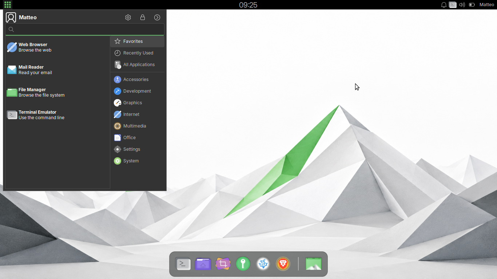
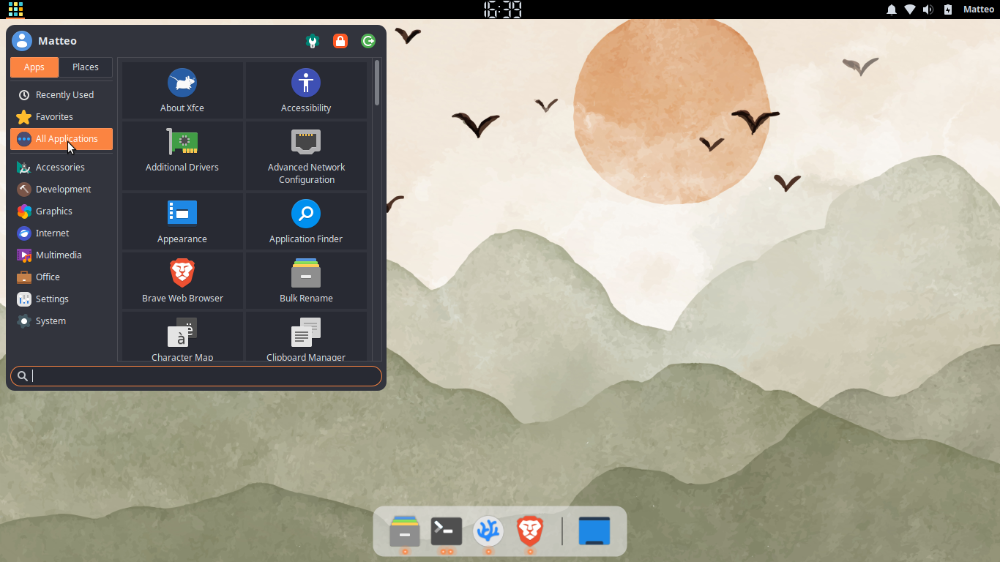
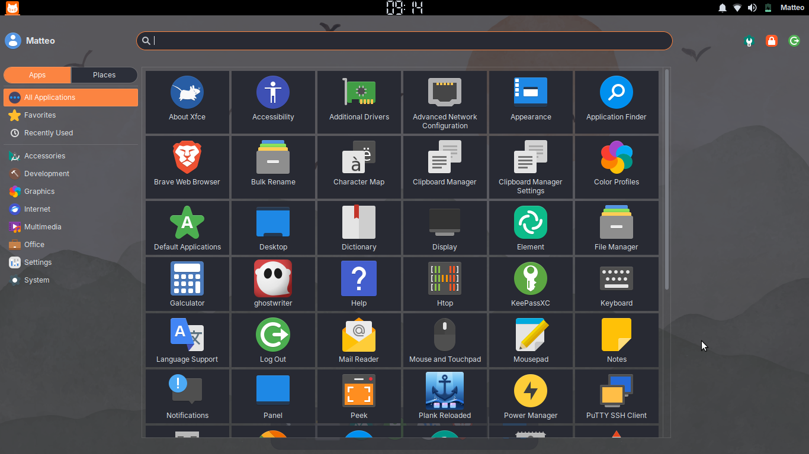
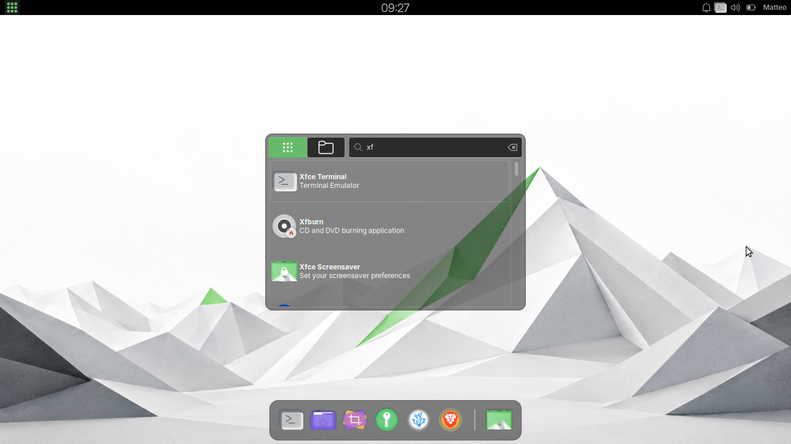

# Presets

A preset is a saved group of appearance and layout settings. Select one from
**Properties → General → Preset** and MeowMenu updates immediately.

A fresh installation starts with **Modern**.

## Built-in presets

### Classic



A compact, traditional launcher. It uses a list, a right sidebar, square
corners, and a solid background. Profile and Session controls are visible.

### Modern



A rounded Docked layout with a left sidebar and Places enabled. Profile and
Session controls are visible, and the Applications/Places switch uses icons.

### Full Screen



A screen-filling launcher with a slightly transparent background. It is well
suited to touch and keyboard use. Places, Profile, and Session controls are
visible.

### Minimal



A small Centered window with a search bar and application list. The sidebar,
Profile, and Session controls are hidden. Places remains available through an
icon switch.

| Preset | Calculator | Applications/Places switch |
|--------|------------|----------------------------|
| Classic | Off | Text |
| Modern | `bc` | Icons |
| Full Screen | `bc` | Text |
| Minimal | `bc` | Icons |

If `bc` is not installed, normal search still works. See the
[Calculator installation notes](installation#optional-calculator-engine).

## Resetting a preset

Selecting a built-in preset restores all of its settings. Selecting it again,
or choosing **Reset preset**, discards changes and restores the original values.

Built-in presets cannot be renamed, deleted, or exported.

## Unsaved changes

Changing a setting covered by the current preset shows **Unsaved custom** in
the preset selector. You can save the new arrangement or select another preset
to discard it.

The selector uses these styles:

- bold for built-in presets;
- regular text for saved custom presets;
- italic text for **Unsaved custom**.

## Managing custom presets

Use **Properties → General**:

- **Save as new…** creates a custom preset from the current settings.
- **Rename…** renames the selected custom preset.
- **Delete** removes it. Deleting the active preset restores **Modern**.
- **Export…** writes the selected custom preset to a file.
- **Import…** loads a preset file and handles duplicate names.

Invalid files are rejected without changing your saved presets. Unknown
settings are ignored, and missing settings use their defaults.

## Advanced: hand-written preset files

A `.meowpreset` file contains `[Preset]` and `[Settings]` sections:

```ini
[Preset]
Name=My Custom Preset
SchemaVersion=1
Id=my-custom
Description=My preset

[Settings]
layout-mode=docked
corner-radius=8
search-bar-position=top
show-profile=true
show-session=true
sidebar-enabled=true
sidebar-position=horizontal
```

Save it as `<id>.meowpreset`. The filename must match the `Id` value. Place it
in:

```text
~/.local/share/meowmenu/presets/
```

Restart the panel with `xfce4-panel -r`. The preset will then appear under
**Properties → General → Preset**.

For descriptions of individual settings, see [Configuration](configuration).
